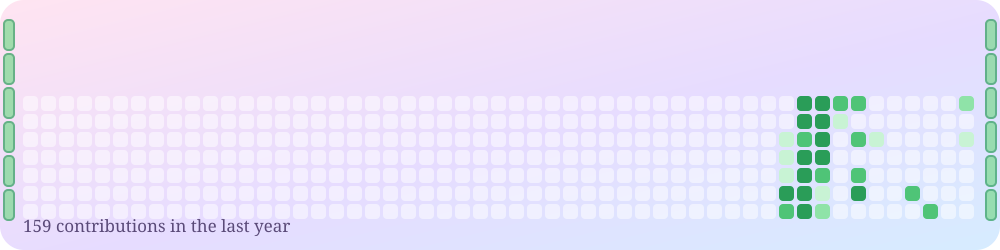

<div align="center">


(˶ᵔ ᵕ ᵔ˶) ᵎᵎ chai first, then code ☕


<p>
  <a href="mailto:pankajsinghdeveloper26@gmail.com"></a>
  <a href="https://www.linkedin.com/in/pankaj-singh-053a2a364"></a>
  <a href="https://twitter.com/pankaj5inghdev"></a>
</p>

✿ ━━━━ ❀ ━━━━ ✿

</div>

## 🌸 hello, world!

> I turn complicated screens into tiny **Flutter** widgets that look the same on every device, and I read data to learn what people click, finish and come back for. ✨

- 📊 data analytics, SEO & predictive models
- 🤖 generative AI, prompt engineering, RAG
- 🧮 data structures & problem solving

```dart
class Pankaj extends Developer {
  final base  = 'New Delhi, India 🇮🇳';
  final focus = ['Flutter', 'Data', 'AI'];
  Widget build(BuildContext c) => Chai(then: Code()); // ☕✨
}
```

## 🎀 skill garden

<p>


</p>

## 🍙 things i've made

- 🎓 **[CampusRoll](https://github.com/pankajsinghdeveloper26/campusroll-attendance-management)**: offline-first attendance app with QR check-in, location checks, analytics and CSV / Excel / PDF export
  `React` `TypeScript` `TanStack` `Tailwind`
- 📈 **[AlphaVision NSE Analytics](https://github.com/pankajsinghdeveloper26/nse-stock-predictor)**: stock analysis and forecasting for Indian markets with SMA, RSI, MACD, XGBoost, Random Forest and LSTM. For learning and research, not financial advice.
  `Python` `Pandas` `scikit-learn` `TensorFlow`
- 📱 **iOS 18 in Flutter**: pixel-perfect iPhone 16 Pro rebuild
  `Flutter` `Dart`

## 🐼 contribution hopper

<div align="center">

</div>

## 🍡 my little journey

| When | Role | Where |
|:--|:--|:--|
| Jun – Aug 2026 | **Data Analyst** (Internship) | Bluestock™ |
| Aug 2025 – now | **Data Analytics & Platform Engineer** | Digital Infrastructure Management |
| Jan 2022 – now | **Frontend & UI Systems Engineer** | Technical Solutions Studio |
| Ongoing | **Maths & Logic Instructor** | Freelance |

## 🏆 achievements unlocked

- ⭐ **Software Engineer Intern**, HackerRank · Sep 2026
- ⭐ **Generative AI Essentials**, TCS iON Career Edge · Aug 2026
- ⭐ **Certified Data Science Professional**, Infosys · Jun 2026
- 🌐 Community Member, **GDG New Delhi** · Oct 2026 – now

## 📊 stats

<div align="center">


</div>

## 💌 say hello

<div align="center">

Got an app to build or a dataset to untangle? **Send it over.** (ﾉ◕ヮ◕)ﾉ*:･ﾟ✧

<a href="mailto:pankajsinghdeveloper26@gmail.com"></a>


</div>
